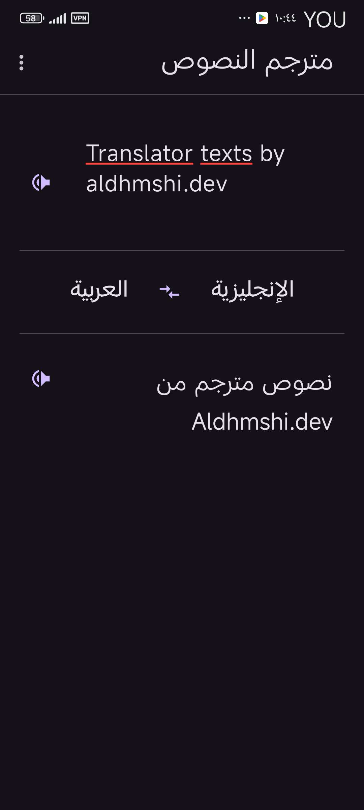
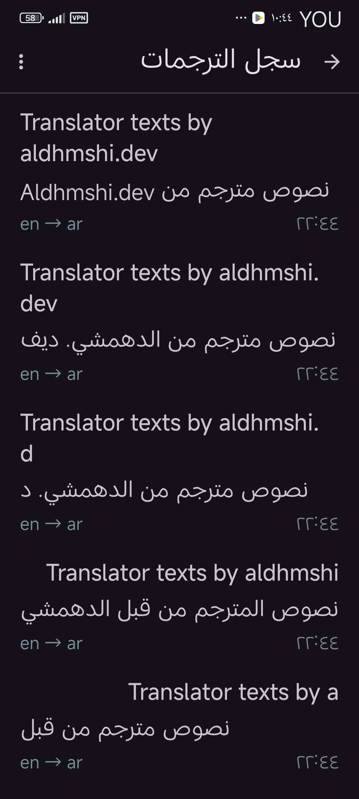

# Arabic-English Translator

An Android application for translating text between Arabic and English. It provides a simple interface, on-device translation, and a local history of previous translations.

## Screenshots

### Translation Screen

### Translation History

## Features

- Translate text between Arabic and English.
- On-device translation using Google ML Kit.
- Download language models when needed.
- Listen to the original text and translated text using Text-to-Speech.
- Automatically detect text changes and translate after a short delay.
- Keep a local translation history.
- View and delete previous translations.
- Save language preferences.
- Simple interface built with Android XML.

## Technologies

- Kotlin
- Android SDK
- XML Layouts
- MVVM Architecture
- Repository Pattern
- Google ML Kit Translation
- Room Database
- DataStore
- Kotlin Coroutines
- StateFlow
- ViewBinding

## Architecture

The application follows the MVVM architecture to separate the UI from the application logic and data operations.

The project uses:

- **UI:** Fragments and XML layouts.
- **ViewModel:** Manages UI state and handles user actions.
- **Repository:** Handles translation, language models, and data operations.
- **Room:** Stores translation history locally.
- **DataStore:** Saves language preferences.

## Download

The APK will be available here after the next release.

**Status:** Coming soon.

## About the Project

I built this project to practice Android development with Kotlin and learn how to organize an application using MVVM and the Repository Pattern.

During development, I worked with local storage, asynchronous operations, and Google ML Kit for on-device translation.

## Developer

**Ahmed Ali Aldhmshi**

- GitHub: [ahmedaldhmshidev-art](https://github.com/ahmedaldhmshidev-art)